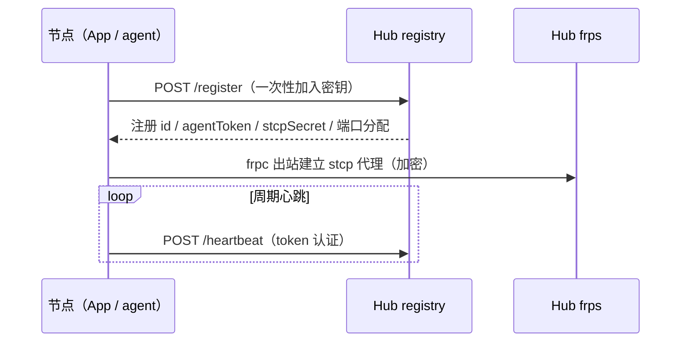
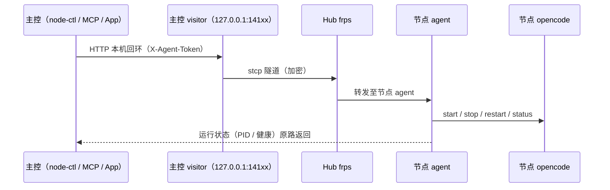
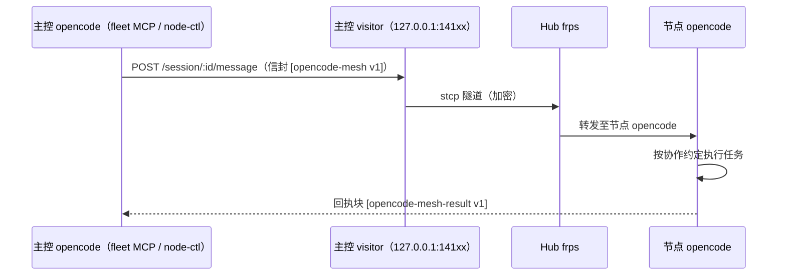

# opencode-mesh · 设计文档

- 版本：v0.14
- 状态：P4 已验收（跨设备派发闭环）；消息协议 v1 已随项目更名（新标记 `[opencode-mesh ...]`，兼容旧 `[aoi-mesh ...]`）；id 身份模型与隧道自动化定稿；安全加固 + 凭据加密存储落地；向导严谨化；MCP 集成一等化（node-ctl 13 工具 + App 一键写入）
- 许可：MIT

---

## 0. 修订摘要

- v0.1 → v0.2：技术选型拍板 **frp + opencode-fleet + 自研 node agent / NodeCtl**；统一 App"单代码多角色"；远程启动流程；MCP 自动写入（备份 + 回滚）；确认 Alibaba Cloud Linux / RPM 优先、无域名可用、仓库名 `opencode-mesh`
- v0.2 → v0.2.1：服务暴露改为 **frp stcp（visitor 模式）**——节点服务零公网暴露，仅 frp 控制口与注册中心端口公开；主控侧通过常驻 frpc visitor 以本机回环端口接入
- v0.2.1 → v0.3：**平权管理模型**（任意注册节点可管理/邀请/吊销，所有者密钥兼容保留）；App 信息架构重组（配置归「组网」、操作归「主控」、Hub 连接单点双写）；新增「生成加入密钥」；Linux 便携包与仓库定位增强（findRepoRoot）
- v0.3 → v0.4：**消息协议 v1**（信封 + 回执 + 澄清块，含宽松回退解析；详见 PROTOCOL.md）；节点改名自动适配（注册状态记录名称，检测不一致自动重新注册并给出指引）；移除「生成加入密钥」按钮（改为脚本/接口手动处理）；界面所有可展开区域支持折叠；「同步节点」自动清理失效节点并自动更新/重启隧道；文档体系规范化（README 重写 + 部署/使用文档）
- v0.4 → v0.5：**身份模型定稿**——节点名是可变标签（全网唯一），注册 token 是不可变的唯一身份；registry 新增 `POST /rename`（改名自动迁移：保留 token / stcp 密钥 / 端口分配，加入密钥归属跟随；重名拒绝），agent 启动时自动迁移或确认名称（幂等；兼容旧状态与旧版 Hub 回退）；**隧道全自动运行**——按需自动生成/启动/更新（同步节点自动刷新重启、App 启动自动拉起），手动停用状态持久化，隧道卡片收敛为「开关 + 日志」
- v0.5 → v0.6：**id 身份模型落地**——registry 以**不可变注册 id**（=首次注册名，如 `dev-node-1`）为键，名称（name）为任意可改的显示标签（全网唯一）；`/register` 同密钥恢复并同步显示名、新注册重名 409（修复同名冒领 token 隐患）；心跳/管理按 token 定位；frp 代理名与 visitors 全部改用 id（改名零影响隧道）；App「组网」页新增注册 id 展示（固定灰字）、节点名可编辑；「主控」节点列表改为卡片式（名称+在线徽标+id+端口/隧道信息+操作）；初始窗口加宽至 620
- v0.6 → v0.7：**首次使用向导**（未配置时自动弹出快速配置；可跳过为纯控制端）；**托盘常驻**——关闭窗口=最小化到系统托盘（首次气泡提示、托盘菜单含显示/退出）、单实例锁（重复启动唤起已有窗口）、「本机」页新增退出按钮；明确生命周期语义：agent 与 frpc 为独立进程，注册与隧道不依赖 App，退出 App 不影响外部设备连接本机
- v0.7 → v0.8：**进程生命周期直连化**——本地 agent / visitor 的发现与停止由 netstat 端口探测改为 **PID 记账（pidfile）+ 存活检测（kill(pid,0)）+ cmdline 身份校验**，端口仅作为服务配置值；killTree 在 Linux 改为进程组回收（消除孤儿）；agent 自证 pidfile 且优雅退出补杀 opencode；**App 打开 = 强制启动本机节点与隧道，App 退出 = 停止两者并直报 Hub 离线**（registry 新增 `POST /offline`，在线→离线即时生效；注册记录保留、其他节点不受影响）；关窗仍为托盘最小化
- v0.8 → v0.9：**命名统一与部署文档重构**——文档与代码统一使用 **opencode-mesh**（功能性名称），界面展示名保留 **Aoi mesh**（窗口标题 / 托盘 / 向导）；消息协议标记更名 `[opencode-mesh v1]` 系列（解析端与协作约定兼容旧 `[aoi-mesh ...]`）；DEPLOY.md 重构——架构与数据流、App 安装/卸载引导、配置字段逐项教学、opencode 相关配置改为官方文档外链；新增 Linux 节点接入脚本（`scripts/node/join.sh`）与 frpc 自动获取
- v0.9 → v0.10：**密码修改流程重构**——「组网」页内联密码输入移除，改为「opencode」行 **⚙ 齿轮弹窗**；修改需先输入**原密码（网络共用密码）验证确认**——比对发生在**节点本机**（mesh-core 与 node.json 现值比对，主进程内完成），Hub 不存密码/指纹；通过后写入配置，agent 运行中经本机回环立即重启 opencode 生效；新密码最少 8 位、与原密码相同将被拒绝
- v0.10 → v0.11：**统一安全加固批次**——`/register` 修复原型链绕过（keys/nodes 改无原型对象 + 自有属性校验 + 密钥格式白名单）；registry 启用**自签 TLS + 客户端指纹钉扎**（指纹随加入密钥以 `密钥.指纹` 组合串分发；握手完成、发送数据前校验，防中间人）；加入密钥默认 72h TTL；审计日志（注册/吊销/改名/密钥签发/鉴权失败）；Hub 服务降权为非 root 专用用户；agent token 恒时比较、opencode 显式 `--hostname 127.0.0.1`；敏感文件（node.json/state.json/nodes.json/visitors.toml/frpc.toml/data.json/audit.log）权限收紧（chmod 600 / Windows icacls）
- v0.11 → v0.12：**凭据加密存储与改密内置化**——新增 `secret-store`（Windows DPAPI / Linux 密钥环 / 600 权限回退）；node.json 明文密码启动时自动迁移为 `passwordEnc`；改密校验下沉到 agent（`POST /opencode/password`，App/脚本不再读取密码值）；主控共享密码 `fleetPasswordEnc` 加密落盘、导出解封/导入封存；node-ctl 新增 `node_dispatch` MCP（加密存储取密，替代 fleet 明文 `--password` 路径）；全网统一密码完成轮换
- v0.12 → v0.13：**向导严谨化与操作文档重构**——首次配置向导密码改为**必填**（≥8 位；取消静默自动生成，杜绝"密码不可知"；加入既有网络须填全网统一密码）；「组网」页保存不再静默生成密码（凭据缺失时引导回向导）；join.ps1/join.sh 新增 `-OpencodePassword/--oc-password`（省略时生成并告警）；DEPLOY 重构为逐步操作手册（Hub 地址三种来源、加入密钥两条路径逐条命令、密码规则与设置步骤），新增「端口与默认值（来历与理由）」章节；Windows 便携包 v1.2.1
- v0.13 → v0.14：**MCP 集成一等化**——node-ctl MCP 补齐为 13 个工具（新增健康检查/会话浏览/会话消息/权限列表与审批/中断/会话重置，能力面覆盖并替代 fleet，凭据经加密存储解封、无明文）；App「主控」页新增 **MCP 集成卡片**（自动定位 opencode 配置 + 手动路径兜底 + 保格式写入（jsonc-parser，唯一运行时依赖）+ 备份回滚 + 路径漂移一键修复 + 移除；默认仅写 node-ctl 并迁移移除 fleet 明文条目）；docs 增补「版本迭代与配置漂移」注意事项；fleet 降级为高级可选

## 1. 定位与设计原则

**一句话**：一个自托管、可 fork 的多机 opencode 协作工具箱——脚本为核心（单点真相），Electron App 为可选图形层。

| # | 原则 | 含义 |
| --- | --- | --- |
| R1 | 脚本优先 | 加入网络、起服务、配转发全部由参数化脚本完成；App 只是同一批逻辑的图形包装，fork 者可以完全不用 App |
| R2 | 自托管 | 用户自带服务器（任意云商/家中服务器）；不依赖任何第三方基础设施；**无域名也可用** |
| R3 | 最小依赖 | 节点侧零提权（frp 用户态转发）；主控编排复用 opencode 原生 MCP |
| R4 | 网络可插拔 | `NetworkProvider` 抽象；v1 参考实现 = frp stcp；WireGuard / Headscale / 自定义中继为候选实现 |
| R5 | 安全默认 | stcp 密钥 + useEncryption 内容加密、全链路密码保护、加入密钥可吊销、示例配置全部占位符、密钥不入库 |

## 2. 角色与术语

| 术语 | 定义 |
| --- | --- |
| **Hub** | 中枢服务器：frps + registry API |
| **节点 Node** | 任意装有 opencode 的机器，运行 node agent（脚本或 App） |
| **主控 Master** | 开启 master 开关的节点，负责向其他节点派发任务（可多个） |
| **加入密钥** | 一次性/可吊销密钥，节点凭它注册进网络 |
| **agent token** | 节点控制凭据（独立于加入密钥），用于远程启停本机 opencode |
| **stcp secret** | 注册时发放的每节点隧道密钥（frp stcp），主控凭它建立 visitor |
| **visitor** | 主控侧常驻的 frpc 进程，把节点服务映射到主控本机回环端口 |

## 3. 架构总图

```
[Hub · 用户自有服务器]  ← 公网仅开放: 22(SSH) + 17000(frp) + 18080(registry)
  ├─ frps（stcp 隧道服务端）
  └─ registry API（注册 / 心跳 / 吊销 / stcp 密钥与端口分配）
        ▲
        │ 各节点出站连接（NAT 友好，无需公网 IP）
   ┌────┴──────────────┬──────────────────┐
[主控节点]           [节点B]            [Linux 节点·headless]
 opencode + fleet     opencode           opencode
 frpc visitor ◀─ stcp 隧道 ──▶ 节点B frpc（stcp 代理，服务不暴露公网）
   └─ 本机 127.0.0.1:14100/14101 ……
 NodeCtl ──▶ 本机回环端口 ──▶ 隧道 ──▶ 节点B agent（start/stop/status）
 fleet_send_message ─▶ 本机回环端口 ──▶ 节点B opencode ──▶ 结果回收
```

**远程启动另一台设备的 opencode（核心场景）**：

1. 每台设备唯一必须常驻的是 **node agent**（轻量进程；桌面 = App 托盘，服务器 = headless 脚本）
2. agent 维持到 Hub 的出站隧道（stcp 代理），并暴露受控 API（仅 opencode 生命周期命令）
3. 主控通过 NodeCtl 工具（MCP 或 CLI）→ 本机 visitor 回环端口 → stcp 隧道 → 目标机 agent → `spawn opencode serve` → 健康检查 → 回报 ready
4. 随后 fleet 经同一链路向该节点 opencode 派发任务，结果原路回收

### 3.1 数据流与网络流（三条典型链路）

**网络流要点**：

- 公网**入向**仅 Hub 的 `17000`（frp 控制口）与 `18080`（registry）；其余全部是设备到 Hub 的**出站**连接（NAT 友好，无公网 IP 亦可）
- 节点与主控之间没有物理直连：两条出站隧道在 Hub 的 frps 汇合，stcp 内容加密
- 主控侧所有节点端口只绑定 `127.0.0.1`（visitor 回环），不回环外暴露

**链路 A · 入网注册与隧道建立**：



**链路 B · 远程生命周期（主控 → 节点 agent）**：



**链路 C · 任务派发与回执（消息协议 v1）**：



## 4. 统一 App（单代码库 · 单安装包 · 角色=配置）

- 同一 Electron 程序装在所有设备；行为由 `node.toml` 开关决定：
  `network.enabled` / `opencode`（总是） / `telegram.token`（可选） / `master.enabled`（可选）
- **GUI 壳 + headless 内核**：核心逻辑在共享 CLI 内核，Electron 仅为壳；Linux 服务器跑 headless 模式（同配置格式），fork 者可纯脚本使用
- **MCP 自动写入**：开启 master → 备份 `opencode.jsonc` → 合并写入 fleet + NodeCtl 配置 → 失败自动回滚；设置提供"仅生成片段"切换（默认自动）
- 托盘常驻（桌面设备）；systemd / 启动文件夹（服务器）
- **界面结构**（v1.3）：「组网」页承载**全部配置**（Hub 连接单点双写、本机节点身份、控制端可选配置与导出/导入）；「主控」页为**纯操作台**（节点同步与远程启停、**生成加入密钥**、隧道、fleet 片段）
- **多控制端 + 平权**：无固定主控；任意设备注册后即可管理全网（凭据平权，所有者密钥兼容）；控制端配置可导出/导入一键复制

### 4.1 节点配置文件（node.toml）

```toml
[server]
address = "hub.example.com:18080"  # Hub registry 地址
join_key = ""                      # 一次性加入密钥

[network]
provider = "frp-stcp"              # NetworkProvider 实现

[opencode]
port = 4096                        # 本机 opencode serve 端口
password = ""                      # 自动生成，强密码

[agent]
port = 41999                       # 受控 API 端口（仅生命周期命令）
token = ""                         # 注册时发放

[telegram]                         # 可选
enabled = false
token = ""
proxy = ""                         # 例：http://127.0.0.1:10090

[master]                           # 可选
enabled = false
```

## 5. Hub 设计

- `frps`：token 认证；**stcp 模式**（服务不由 frps 直接暴露端口，仅做加密中继）；有域名后可加 TLS
- **registry API**（Node.js 单进程；JSON 存储）：

| 方法 | 路径 | 说明 |
| --- | --- | --- |
| POST | `/register` | 加入密钥 → 校验 → 分配 stcp 密钥与绑定编号 → 返回节点配置 |
| POST | `/heartbeat` | 节点存活/版本上报 |
| GET | `/nodes` | 节点列表（**注册节点凭据**或所有者密钥；含 stcpSecret/token，供控制端生成 visitor） |
| GET | `/admin/frps` | frps 连接信息（注册节点凭据或所有者密钥） |
| POST | `/admin/keys` | 生成一次性加入密钥（注册节点凭据或所有者密钥） |
| POST | `/admin/revoke` | 吊销节点与密钥（注册节点凭据或所有者密钥） |

- 部署：`install.sh`（RPM 优先、DEB 兼容）、systemd 单元；安全组只需放行 **22 + 17000 + 18080**

## 6. 节点 agent 规格

- **agent API**（本机 `127.0.0.1:41999`，经 stcp 隧道 + visitor 供主控访问）：

| 方法 | 路径 | 说明 |
| --- | --- | --- |
| POST | `/opencode/start` | 启动 `opencode serve`（绑 127.0.0.1 + 密码） |
| POST | `/opencode/stop` | 停止（按端口找 PID 并终止） |
| POST | `/opencode/restart` | 重启 |
| GET | `/opencode/status` | 运行状态 / PID / 健康 |
| GET | `/health` | agent 自身健康 |

- 鉴权：Header `X-Agent-Token`（注册时发放，可吊销）
- **刻意不做任意命令执行**——agent 是钥匙，不是后门
- 看护：agent 对 opencode 做定期健康检查与自动重启（与现有 auto-restart 同款逻辑）

## 7. 编排层

- **opencode-fleet**（现成 MCP）：
  - `fleet_send_message` 异步派发（fire-and-forget）→ `fleet_get_session_status` 轮询 → `fleet_get_session_messages` 回收结果
  - `fleet_reply_permission` 远程批准/拒绝节点权限请求
- **NodeCtl**（自研小件）：
  - `node_opencode_start / stop / restart / status`、`node_list`
  - 形式：MCP（主控 opencode 原生调用）或 CLI（零依赖）
  - 另含 `visitors-config`：从 registry 拉取节点与 stcp 密钥，生成主控侧 frpc visitor 配置
- 典型手机流程：Telegram → 主控 opencode → NodeCtl 启动节点 → fleet 派发 → 汇总回复

## 8. 安全设计

| 威胁 | 对策 |
| --- | --- |
| 公网端口扫描 | **stcp：节点服务零公网暴露**；公网仅 frp 控制口（token）与 registry（admin/join 密钥） |
| registry 嗅探 / 中间人 | **HTTPS（自签）+ 客户端指纹钉扎**：指纹随加入密钥以 `密钥.指纹` 分发，握手完成、发送数据前校验；HTTP 仅作未启用 TLS 的兼容回退 |
| 隧道窃听 | stcp secretKey + `transport.useEncryption` 内容加密（双向一致） |
| 加入密钥泄露 | 一次性密钥 + 可吊销 + **默认 72h TTL** + 注册/吊销审计留痕 |
| 恶意输入绕过鉴权 | keys/nodes 使用无原型对象 + 自有属性校验；加入密钥格式白名单（hex） |
| Hub 进程失陷 | registry / frps 以专用非 root 用户运行（最小权限） |
| 本机凭据文件泄露 | node.json / state.json / nodes.json / visitors.toml / frpc.toml / data.json / audit.log 权限收紧（Linux chmod 600；Windows icacls 仅当前用户） |
| 节点被越权操作 | agent 仅生命周期命令 + agent token（恒时比较）；opencode `permission` 模板（deny 默认；ask → 主控远程批） |
| 主控侧访问 | visitor 仅绑定 127.0.0.1（不回环外暴露）；stcp 密钥仅存节点本地与 registry（admin 可见） |
| 开源泄露 | 示例全部占位符；`.gitignore` 覆盖 `.env`/密钥/`nodes.json`/`state.json`；真实配置只存本地 |
| 管理权限模型 | **平权**（v0.3）：任意注册节点可管理/邀请/吊销；所有者密钥兼容保留，可按需收紧（成员间管理面隔离属路线图模块 D） |

## 9. 网络后端抽象（为 fork 者预留）

```
NetworkProvider 接口：
  join(key) / leave()
  status() -> {online, latency}
  exposeLocal(port) -> remoteEndpoint
  connectRemote(nodeKey) -> localPort
```

- v1 实现：**frp stcp**（零提权；服务零暴露；自动重连）
- 候选实现（文档路线）：WireGuard 自管（通用 IP 层）、Headscale（P2P + ACL）、SSH 反向隧道、自定义 WS 中继

## 10. 部署与验收

- **Hub**：Alibaba Cloud Linux / CentOS 优先（RPM），Ubuntu / Debian 兼容；`install.sh` 幂等可重跑
- **节点**：Windows（启动文件夹 / 计划任务）、Linux（systemd）；无域名、无公网 IP、家庭 NAT 均可加入
- **安全组**：仅 22 / 17000 / 18080 三个端口
- **验收标准**：全新机器从零到"节点在线且可被派发任务" ≤ 10 分钟

## 11. 路线图

| 阶段 | 内容 | 状态 |
| --- | --- | --- |
| P0 | 设计冻结（本文档）+ 仓库重构为 opencode-mesh | ✅ |
| P1 | node-app v1.1：本机管理面板（诊断 / 日志 / Token 轮换 / 图标 / 设备卡片布局） | ✅ |
| P2 | frp PoC + node agent + NodeCtl（CLI/MCP，本地端到端验证） | ✅ |
| P3 | Hub 安装脚本 + 阿里云实机部署 + stcp 零暴露改造（公网全链路验证） | ✅ |
| P4 | 编排集成（fleet）+ 第二节点 join 验收（手机全链路） | ⏳ |
| P5 | Linux 节点支持 + 开源化（README / LICENSE / CI） | ⏳ |

## 12. 开放问题

- LICENSE 文件在 P5 补齐（MIT）
- Hub 的 Docker 部署作为 P5 可选交付
- 多主控场景的冲突策略（同一节点被两个主控派发）在 P4 讨论
- 主控侧 visitor 进程的常驻管理（自动启动/看护）随 P4 的 App 化一并处理

---

## 附录 A · 参考部署环境

> 供运维参考，不含任何密钥。

- 参考 Hub：Alibaba Cloud Linux 3，frps(17000) + registry(18080)，systemd 单元 `opencode-mesh-frps` / `opencode-mesh-registry`
- 节点 App 位置：`node-app/`（Electron 44.7.1，Node.js 22.23.2）
- 节点 agent：`node-agent/`（配置 `node.json`，状态 `data/state.json`，日志 `data/agent.log`）
- bot 配置与日志目录：`%APPDATA%\opencode-telegram-bot\`（`.env`、`logs/`、`settings.json`）
- 开机自启：`%APPDATA%\Microsoft\Windows\Start Menu\Programs\Startup\opencode-telegram-bot.vbs`
- 桌面快捷方式：`opencode-mesh 节点.lnk`
- opencode serve 端口：`4096`（本机回环）

## 附录 B · 术语对照（中英）

| 中文 | 英文 | 说明 |
| --- | --- | --- |
| 中枢 | Hub | 用户自托管服务器 |
| 节点 | Node | 装入网络的设备 |
| 主控 | Master | 派发任务的节点 |
| 加入密钥 | Join Key | 节点注册凭据 |
| 节点代理 | node agent | 常驻的节点管理进程 |
| 访客端 | visitor | 主控侧的 stcp 接入进程 |
